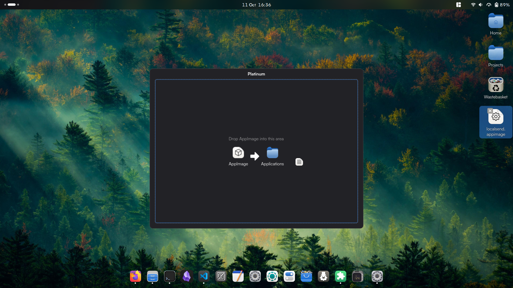

# Platinum

Platinum is tool that helps you manage AppImages as simple as drag and drop.

## Work In Progress

- [X] Create a Platinum Drop Window.
- [X] Dragging file detection.
- [x] Create AppImage validation.
- [x] Extract metadata from the AppImage.
- [x] Create a `.desktop` file generator.
- [ ] User confirmation dialog.
- [ ] AppImage manager