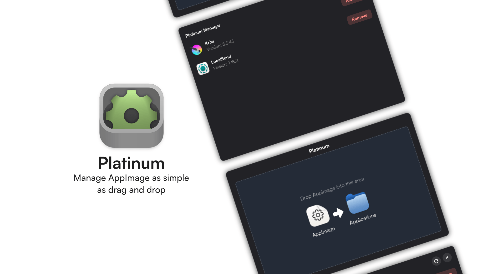

# Platinum

Platinum is a tool that helps you manage AppImages with drag and drop.



## Install on Your Distro

Run this setup script:

```sh
curl -fsSL https://raw.githubusercontent.com/abcdavk/platinum/refs/heads/main/tools/setup.sh | bash
```

To uninstall:

```sh
curl -fsSL https://raw.githubusercontent.com/abcdavk/platinum/refs/heads/main/tools/uninstall.sh | bash
```

## Platform support

Platinum currently supports GNOME and requires the Nautilus file manager. Other desktop environments and file managers are not supported.

## Build and run

Install Rust, Cargo, and the native GTK build dependencies. Platinum needs GTK 4.12 or newer and libadwaita 1.8 or newer. On Debian or Ubuntu (use a release/repository that provides these versions):

```sh
sudo apt install build-essential pkg-config libgtk-4-dev libadwaita-1-dev blueprint-compiler
```

Run Platinum from the project directory:

```sh
cargo run
```

Build an optimized executable:

```sh
cargo build --release
```

The executable will be available at `target/release/platinum`.

## Work In Progress

- [x] Create a Platinum Drop Window.
- [x] Dragging file detection.
- [x] Create AppImage validation.
- [x] Extract metadata from the AppImage.
- [x] Create a `.desktop` file generator.
- [x] User confirmation dialog.
- [x] AppImage manager.
- [ ] Add DwarFS AppImage support.
- [ ] Icon changer.
